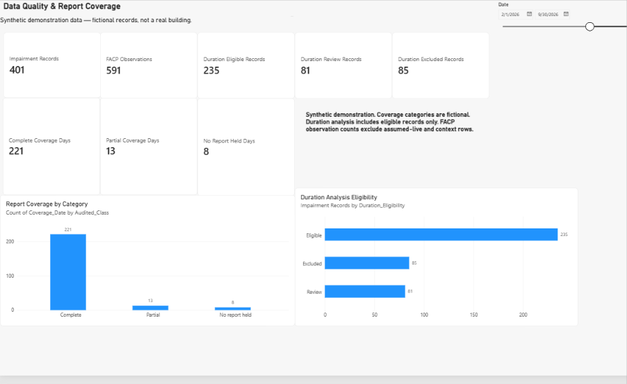
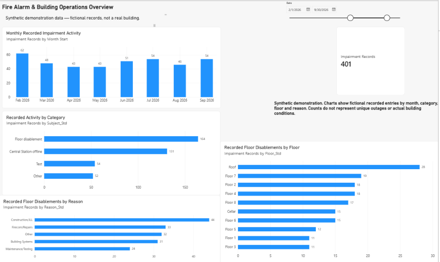
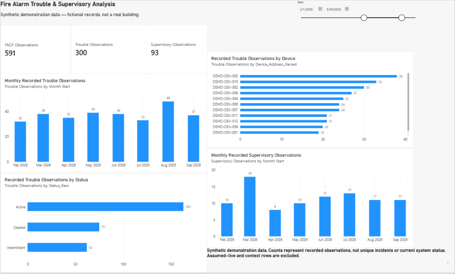
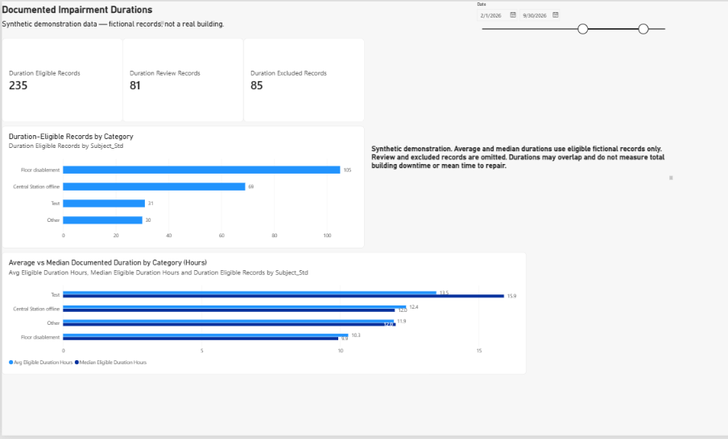

# Fire Alarm & Building Operations Analytics

**Starky Paulino | Excel · Power Query · Power BI · DAX**

## Project overview

Built a four-page Power BI report to explore recorded building-system impairments, floor activity, recurring trouble and supervisory observations, report coverage, and documented durations.

The project combines fire-life-safety domain knowledge with data preparation, modeling, visualization, and careful treatment of incomplete operational records.

**Status:** Four-page Power BI report built and refresh tested. Public screenshots use synthetic demonstration data. The internal operational analysis remains provisional while source-review questions are unresolved.

## Business questions

- How does recorded impairment activity vary by month?
- Which floors and reasons appear most often in floor-disablement records?
- Which devices have recurring trouble observations?
- How complete is the reporting coverage?
- What do eligible records show about documented durations?

## Tools and approach

- **Excel:** source inventory, preparation tables, stable identifiers, and validation checks.
- **Power Query:** table imports, data types, and transformations.
- **Power BI:** a shared date model, interactive report pages, and date filtering.
- **DAX:** record counts, observation counts, reporting coverage, and eligible average and median durations.

## Preparation and modeling

- Preserved source records and assigned fixed record identifiers.
- Kept original labels alongside standardized categories.
- Flagged missing times, uncertain dates, possible repeats, and unresolved mappings.
- Separated directly observed Fire Alarm Control Panel (FACP) conditions from context and assumed-live entries.
- Classified durations as eligible, requiring review, or excluded.
- Connected four preparation tables to a shared date table using one-to-many relationships.
- Created measures that keep recorded activity, observations, coverage, and duration eligibility distinct.

## Report pages

| Page | Purpose |
|---|---|
| Data Quality & Coverage | Reporting coverage and duration eligibility |
| Operations Overview | Monthly activity, categories, floors, and reasons |
| Trouble & Supervisory | Recorded observations by month, device, and status |
| Documented Durations | Eligible record counts and average versus median durations |

## Analytical decisions

### Recorded observations versus unique incidents

A condition can appear in several shift reports. Repeated sightings are counted as observations, without assuming each sighting represents a new incident.

### Missing reports versus event-free days

Reporting coverage is shown separately from activity. A day without a report is not treated as a day without events.

### Duration eligibility

Average and median durations use eligible records only. Missing, excluded, and review records remain identifiable rather than being assigned zero durations.

### Average versus median

Both measures are displayed so readers can see when long durations affect the average. Eligible record counts provide context for each category.

## Interpretation and limitations

- Recorded observations are not unique incident counts or a measure of current system status.
- Reporting practices changed in August 2026 in the internal source data, limiting comparisons across that change.
- January has limited source coverage, and October is partial. February–September 2026 is the default comparison window.
- A day without a report is not evidence of an event-free day.
- Duration analysis includes eligible records only.
- Durations may overlap and do not measure total building downtime or overall mean time to repair.
- Unresolved source questions may change the internal results.
- Public demonstration results are fictional and should not be interpreted as operational findings.

## Validation

- Checked record totals and duration classifications.
- Tested date filtering and chart interactions.
- Resolved Power Query conversion errors while preserving source text.
- Refreshed the data and schema without reported errors.
- Saved a separate reviewed Power BI backup.
- Connected a separate demonstration report to synthetic data and checked its headline totals.

These checks establish report behavior and internal consistency. They do not establish that every operational source record is accurate.

## Public demonstration and privacy

The operational workbook, source records, and internal Power BI file are not included in this repository.

The screenshots below use fictional records generated for this portfolio. They demonstrate the report design and analytical logic without describing actual building conditions.

The August 2026 recording-practice limitation applies to the internal source data, not the synthetic demonstration.

## Report screenshots

All four screenshots use the demonstration reporting window of February 1–September 30, 2026.

### Data Quality & Coverage

Shows fictional reporting coverage and the number of records eligible for, excluded from, or awaiting review for duration analysis.

### Operations Overview

Shows fictional monthly activity, recorded categories, floor-disablement patterns, and reasons.

### Trouble & Supervisory

Shows fictional trouble and supervisory observations by month, device, and recorded status.

### Documented Durations

Compares average and median documented durations across categories, alongside eligible record counts.

## Intended management use

The report is designed to help operations teams:

- Identify recurring recorded conditions for investigation.
- Compare floor activity and reasons for disablement.
- Identify gaps in reporting and time documentation.
- Review duration patterns with their eligibility and sample-size context.
- Prioritize source review before drawing conclusions about reliability.

No measured reduction in downtime, response time, or operational risk is claimed.

## Skills demonstrated

Excel data preparation, Power Query transformations, dimensional modeling, DAX, interactive Power BI reporting, data-quality assessment, and analytical communication.

## Author

**Starky Paulino**  
Data Analyst / BI Analyst
